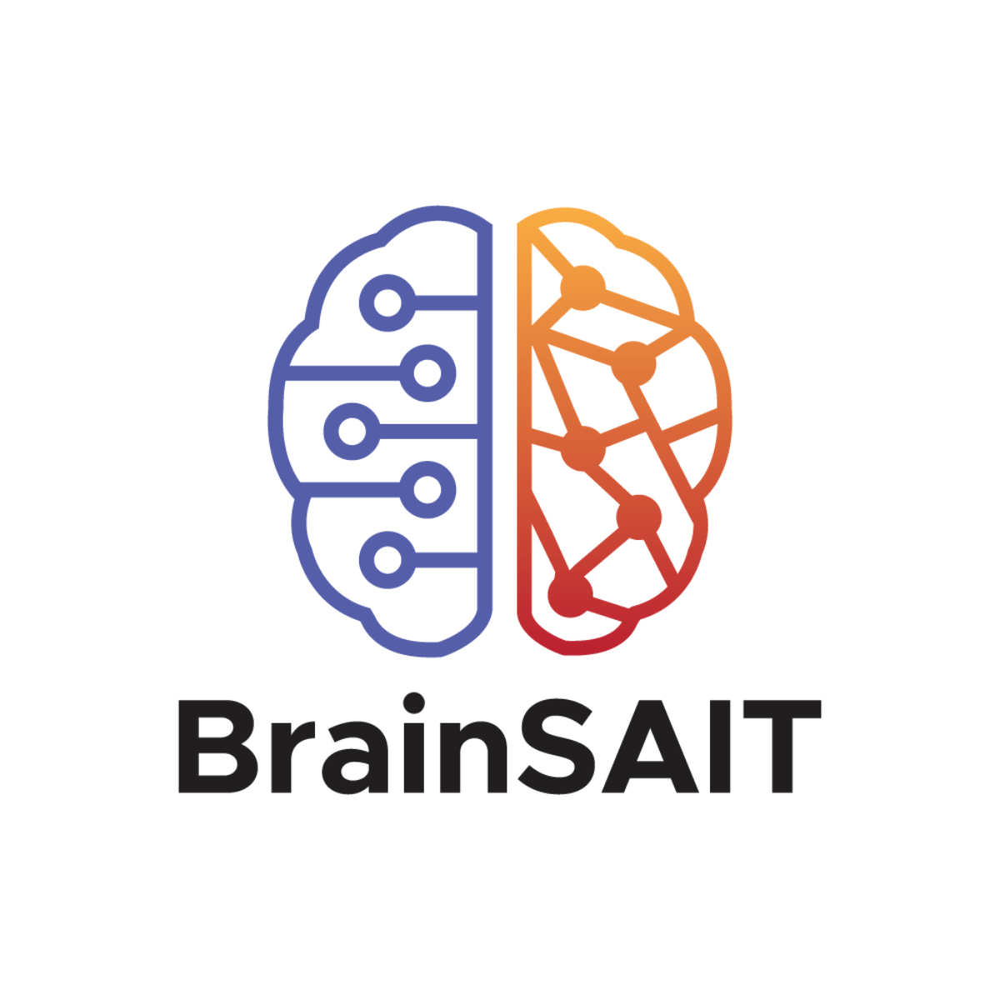
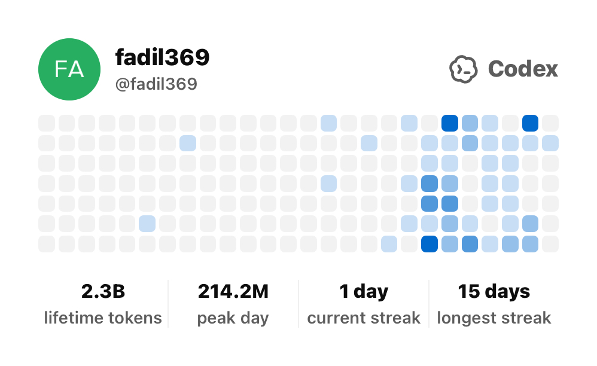

# Dr. Mohamed El Fadil Abuagla
### د. محمد الفاضل أبوعاقلة

**Physician · Founder & CEO, BrainSAIT Ltd · Healthcare AI Builder**

**Building AI-native healthcare infrastructure for Saudi Arabia & MENA**

طبيب ورائد أعمال تقني — أبني بنية تحتية صحية قائمة على الذكاء الاصطناعي للسعودية والمنطقة

**Riyadh, Saudi Arabia · UK-incorporated BrainSAIT Ltd · Arabic / English**

---

## From clinical practice to connected healthcare

I'm **Dr. Fadil**, a physician and technology entrepreneur working at the intersection of clinical care, artificial intelligence, and business. My clinical journey began in 2010; experience in emergency care, surgical teams, and hospital claims workflows shapes the problems I choose to solve.

Through **BrainSAIT**, I am building a digital nervous system for healthcare: connected agents, interoperable data, provider identity, and automation that helps people move from an idea to a working solution.

My focus is **Arabic-native clinical AI**, **Saudi healthcare interoperability**, and **human-reviewed, auditable workflows**. I care about measurable improvements in documentation quality, claims completeness, and the patient journey.

أنا **د. فاضل**، طبيب ومؤسس **برينسايت — BrainSAIT**. بدأت رحلتي السريرية عام 2010، وأسهم عملي في الطوارئ والفرق الجراحية ومسارات المطالبات بالمستشفيات في تحديد المشكلات التي أعمل على حلّها.

أبني منظومة تربط الوكلاء الذكيين والبيانات الصحية وهوية مقدمي الرعاية والأتمتة؛ لتحويل الأفكار إلى حلول عملية. أركّز على الذكاء الاصطناعي السريري باللغة العربية، والتشغيل البيني في القطاع الصحي السعودي، وسير عمل قابل للتدقيق يخضع للمراجعة البشرية.

## What I'm building | ما أبنيه

These are the main workstreams in the BrainSAIT ecosystem. Public repositories below provide implementation context; individual products have their own development and deployment milestones.

| Workstream | Focus |
| --- | --- |
| **LINC Agent Suite** | MasterLinc orchestration; ClinicalLinc, ClaimLinc, ComplianceLinc, BridgeLinc, and RadioLinc workstreams for clinical, financial, integration, and imaging workflows. |
| **SBS & revenue-cycle automation** | Saudi billing workflows, claims normalization, documentation completeness, rejection analysis, eligibility, and prior authorization. |
| **BrainSAIT Provider Registry (BPR)** | Provider identity and verification; OID, IDN, and SPID identity work, provider profile passports, and provenance. |
| **GIVC & Oasis+** | Clinician workspace and enterprise integration work: EHR access, documentation, coding assistance, and connections to hospital systems. |
| **Basma & HNH** | Arabic/English voice experiences and connected patient-journey workflows. |
| **MCP & automation infrastructure** | Healthcare tool connectors, per-user access, audit trails, workflow automation, and separation of read/write capabilities. |
| **BrainSAIT Academy** | Practical learning for healthcare professionals, developers, entrepreneurs, and institutions. |

### Current priorities · October 2026

- **Clinical evidence:** define intended use, evaluate Arabic/English performance, and document human-review rules for clinical AI.
- **Interoperability:** connect FHIR R4 workflows with Saudi NPHIES requirements and existing hospital systems.
- **Provider trust:** strengthen BPR verification, identity provenance, and profile-publication workflows.
- **Governed automation:** build traceable agent actions, role-based access, and privacy-aware data handling.
- **Learning to delivery:** connect education, implementation, and reusable solutions through **LEARN → BUILD → SOLUTIONS**.

**الأولويات الحالية:** تقييم الذكاء السريري بالعربية والإنجليزية، وربط الأنظمة الصحية، وتعزيز التحقق من هوية مقدمي الرعاية، وبناء أتمتة قابلة للتتبّع، وتحويل التعلّم إلى تنفيذ وحلول قابلة للاستخدام.

## Selected public projects | مشاريع مختارة

| Project | Explore |
| --- | --- |
| **MasterLinc** | [Medical imaging orchestration, RadioLinc, PACS/viewer integration, and communication workflows](https://github.com/Fadil369/masterlinc) |
| **BrainSAIT RCM** | [Healthcare claims and rejections management with Saudi interoperability work](https://github.com/Fadil369/brainsait-rcm) |
| **Healthcare MCP Extension** | [FHIR tooling, healthcare connectors, access controls, and audit capabilities](https://github.com/Fadil369/brainsait-mcp-dxt) |
| **NPHIES Course Platform** | [Explore the healthcare interoperability learning project](https://github.com/Fadil369/nphies-course-platform) |
| **BrainSAIT Academy** | [Explore the academy application repository](https://github.com/Fadil369/brainsait-academy) |
| **The Republic of Cells · جمهورية الخلايا** | [A bilingual literary project exploring the human body as a living republic](https://github.com/Fadil369/republic-of-cells) |

[Browse my repositories →](https://github.com/Fadil369?tab=repositories)

## Engineering approach | منهجي في البناء

| Layer | Tools & interests |
| --- | --- |
| **Services & APIs** | Python, FastAPI, TypeScript, Node.js, NestJS |
| **Web & mobile** | Next.js, React, Expo / React Native; continued learning in Swift and SwiftUI |
| **Infrastructure** | Cloudflare Workers, D1, R2, and Tunnels; Docker |
| **Agents & workflows** | MCP, n8n, API integration, agent orchestration |
| **Healthcare data** | FHIR R4, NPHIES workflows, clinical documentation, terminology, provider identity |
| **Quality & governance** | Playwright, observability, audit trails, role-based access, privacy-aware evaluation |

**Design priorities:** Arabic RTL / English LTR, usable clinician interfaces, human oversight, and evidence that can be reviewed.

**Governance focus:** PDPL and CHI requirements in Saudi Arabia, with privacy and security controls appropriate to each deployment.

## LEARN → BUILD → SOLUTIONS

**Learn practical skills. Build around real problems. Deliver useful solutions.**

| Path | Purpose |
| --- | --- |
| **LEARN · تعلّم** | Practical education, labs, and resources for healthcare, business, development, and institutional teams. |
| **BUILD · ابنِ** | Turn a defined problem into a prototype, integration, or implementation through the BUILD Ticket pathway. |
| **SOLUTIONS · حلول** | Explore healthcare workflows, reusable templates, and agent-based tools for operational needs. |

[Explore BrainSAIT](https://brainsait.de) · [Portfolio & offerings](https://fadil369.github.io)

## Research, teaching & writing | البحث والتعليم والكتابة

I connect clinical observations with research questions, teach through practical examples, and write in Arabic and English about health, identity, technology, and human systems.

My writing projects include **The Republic of Cells**, **Dark and Lemon**, **Between One Beat and Another**, and **Raising Humans**.

[Google Scholar](https://scholar.google.co.jp/citations?user=G018qlYAAAAJ&hl=en) · [The Republic of Cells](https://github.com/Fadil369/republic-of-cells)

أربط الملاحظة السريرية بالسؤال البحثي، وأؤمن بالتعلّم عبر التجربة والتطبيق. أكتب بالعربية والإنجليزية عن الصحة والهوية والتقنية والأنظمة الإنسانية، ومن مشاريعي: **جمهورية الخلايا**، و**داكن وليموني — Dark and Lemon**، و**بين نبضة وأخرى**، و**Raising Humans**.

## Building with Codex | البناء باستخدام Codex

I use AI-assisted engineering to explore ideas, develop integrations, and iterate on the BrainSAIT ecosystem.

| Metric shown in the snapshot | Value |
| --- | --- |
| Lifetime tokens | **2.3B** |
| Peak-day tokens | **214.2M** |
| Current streak | **1 day** |
| Longest streak | **15 days** |

User-provided Codex activity snapshot, shared 13 October 2026. These are Codex usage metrics; the image is a static snapshot.

أستخدم أدوات البرمجة المدعومة بالذكاء الاصطناعي لاستكشاف الأفكار وبناء التكاملات وتطوير منظومة برينسايت. تعرض الصورة إحصاءات استخدام Codex كما شاركتها في 13 أكتوبر 2026.

## Let's collaborate | لنتعاون

I'm interested in working with:

- **Healthcare teams** on documentation quality, claims workflows, and clinical AI evaluation.
- **Developers and researchers** on FHIR integration, Arabic clinical NLP, provider identity, and agent tooling.
- **Educators and institutions** on practical digital-health and AI training.
- **Founders and partners** bringing useful healthcare technology to Saudi Arabia and MENA.

[LinkedIn](https://www.linkedin.com/in/fadil369) · [Book a conversation](https://calendly.com/fadil369) · [X](https://x.com/brainsait369) · [BrainSAIT](https://brainsait.de)

---

**Original Intelligence × Artificial Intelligence**

Collective brainpower. Solutions, Automated, Integrated.

ذكاء الإنسان × الذكاء الاصطناعي — حلول نبتكرها معاً لخدمة الإنسان.

**LEARN → DO → TEACH → SELL**

Profile updated: 13 October 2026 · آخر تحديث: 13 أكتوبر 2026

